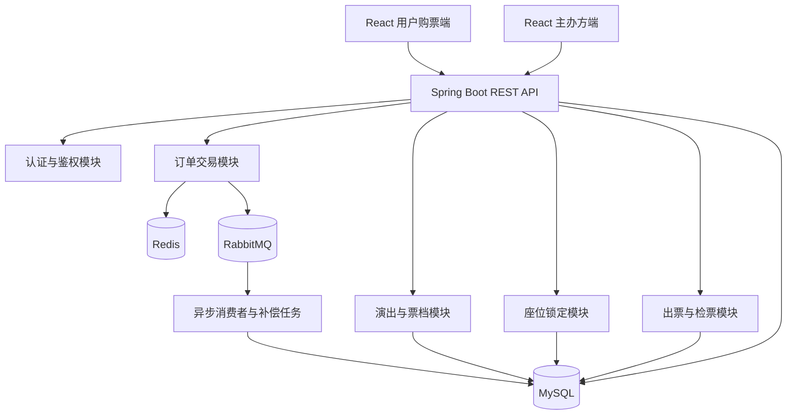
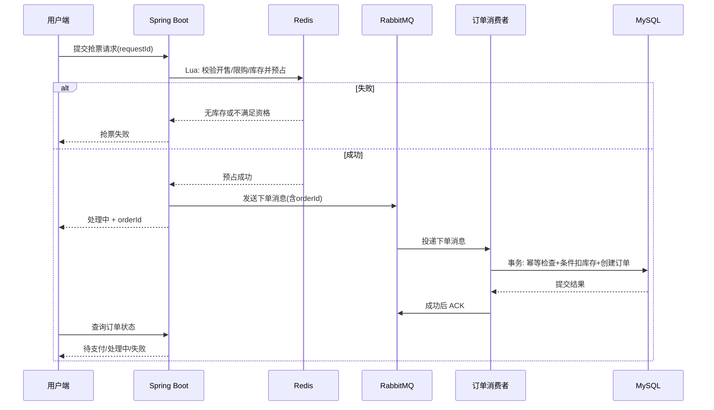

# TicketFlow — 高并发票务预约与交易平台

> **项目定位**：面向 Java 全栈实习求职的独立实战项目，以真实票务交易为业务背景，重点展示 Spring Boot 业务建模、Redis 高并发控制、RabbitMQ 异步处理、MySQL 事务一致性，以及 React 可视化选座能力。
>
> **文档版本**：v1.0  ·  **日期**：2026-11-07  ·  **项目形态**：模块化单体应用（首版）

---

## 1. 项目概述

### 1.1 项目简介

TicketFlow 是一个支持演出发布、场次和票档管理、限时抢票、指定座位锁定、订单支付、电子票生成、入场检票、退票退款的票务预约与交易平台。

系统提供：

- **用户购票端**：演出列表、场次详情、票档或座位选择、抢票、订单查询、模拟支付、电子票与退票。
- **主办方管理端**：演出与场次管理、票档定价、场馆座位模板、库存管理、订单查询、扫码/输码检票、销售统计。
- **平台管理端（可选）**：主办方审核、违规活动管理、账号与异常订单管理。

### 1.2 与传统秒杀教学项目的区别

教学型优惠券秒杀项目通常聚焦“是否抢到库存 + 创建订单”，本项目进一步覆盖：

1. **票档抢购与指定座位购票**两种库存模型；
2. **座位生命周期**：可选 → 锁定 → 售出，超时则释放；
3. **订单生命周期**：待支付 → 已支付/已取消 → 已出票/已退票；
4. **异常一致性**：重复提交、重复消费、消息丢失、支付与超时关闭竞争；
5. **履约闭环**：出票、现场检票、防重复入场、退票和数据统计；
6. **全栈体验**：交互式座位图与实时状态同步。

### 1.3 核心目标

- 能独立部署并完整演示“发布演出 → 购票 → 支付 → 出票 → 检票”的交易闭环。
- 在高并发请求下，**不超卖、不重复售出同一场次座位**。
- 在重复消息、重复请求、服务崩溃等条件下，**业务操作具备幂等性并可恢复**。
- 有压测数据、异常测试和技术设计文档支撑简历陈述。

### 1.4 不包含在首版的功能

真实第三方支付、实名制票务、复杂防黄牛策略、跨区域多活、真实电子发票、复杂场馆 SVG 建模、多租户结算等暂不实现。首版采用**模拟支付**，不得对外宣称已接入真实资金交易。

---

## 2. 用户角色与业务需求

| 角色 | 主要能力 |
| --- | --- |
| 普通用户 | 注册登录、浏览演出、选择场次票档、选座、下单、模拟支付、电子票、退款申请 |
| 主办方负责人 | 发布活动、管理场次与票档、查询订单、核验电子票、查看统计 |
| 平台管理员（P2） | 审核主办方、管理活动和异常数据 |

### 2.1 用户端功能

- **账号**：注册、登录、退出、查看个人资料；JWT 认证。
- **演出查询**：列表、分类、搜索、场次与票档详情。
- **票档购买**：不选座票档，选择数量，检查限购与库存。
- **指定座位**：展示座位图，选择座位并尝试锁座，显示锁定倒计时。
- **订单**：查询待支付/已支付/已取消/已出票/已退款等订单，支持超时关闭。
- **模拟支付**：点击模拟支付按钮，触发服务端可靠的支付结果处理。
- **电子票**：生成不可预测的票券凭证，展示二维码与入场须知。
- **退票**：未检票时按活动规则发起退票；退款成功后票券作废。

### 2.2 主办方端功能

- 演出信息 CRUD、上下架、场次配置；
- 票档价格与总量设置、开售和停售时间、限购策略；
- 场馆区域与座位模板管理；为每个场次生成独立的座位状态；
- 订单查询、票券核验（含权限校验）、核验日志；
- 销售额、订单量、售罄率、已检票数等统计。

---

## 3. 购票模式与业务规则

### 3.1 模式一：按票档抢购（不选座）

适合音乐节站票及普通活动。用户选择场次、票档和数量，无须选择具体座位。

**关键规则**：

- 每个 `ticket_tier` 隶属于一个 `event_session`；
- 活动仅在可售时间内允许购买；
- 限购按用户 + 场次/票档配置执行；
- Redis Lua 负责原子资格校验与**预占**，MySQL 条件扣减负责持久化约束；
- 订单创建失败必须最终释放预占；
- 重复消费不应创建重复订单或重复扣减库存。

### 3.2 模式二：指定座位购票

适合演唱会、剧场等。用户选择某场次的具体座位。

**关键规则**：

- 一个物理座位可被不同场次复用，但同一场次只允许卖给一个订单；
- 在确认订单时，后端原子检查并锁定座位；
- 多座位下单必须**全部锁定成功才提交**，否则全部回滚；
- 锁定与订单绑定，且有明确超时时间；
- 支付成功后，锁定座位转为已售；
- 超时关闭只允许释放**仍归属于该订单**的锁定；
- 页面显示的座位状态只是提示，最终判定以服务端数据库事务为准。

### 3.3 模拟业务示例

演出“城市音乐节”共 5,000 张票：VIP 500 张（¥1,280）、A 区 1,500 张（¥680）、B 区 3,000 张（¥380）。该数据用于演示，并非真实商家或活动。

---

## 4. 技术栈与架构

| 层次 | 推荐技术 | 用途 |
| --- | --- | --- |
| Java | JDK 17 或 21 | 后端语言 |
| Web | Spring Boot 3 + Spring MVC | API 服务 |
| 数据访问 | MyBatis-Plus | CRUD 与自定义条件 SQL |
| 安全 | Spring Security + JWT | 身份认证及角色鉴权 |
| 关系数据库 | MySQL 8 | 订单、座位、票券等核心数据 |
| 缓存/并发 | Redis、Lua、Redisson（按需） | 活动缓存、库存预占、限流 |
| 消息队列 | RabbitMQ | 异步订单、超时任务、通知 |
| 实时通信 | WebSocket 或 SSE | 座位状态推送；需配合重连补快照 |
| 用户端 | React + TypeScript | 用户购票 H5 |
| 主办方端 | React + Ant Design | 管理后台 |
| 测试 | JUnit 5、Testcontainers、JMeter | 单测、集成测试、压测 |
| 运维 | Docker Compose、Nginx | 本地/服务器部署 |

### 4.1 总体架构



**首版坚持模块化单体**：将业务按模块分离，统一一个 Spring Boot 进程。只有在真实性能瓶颈或团队协作需求出现后，再考虑微服务拆分。

### 4.2 推荐代码目录

```text
TicketFlow/
├── backend/
│   ├── src/main/java/com/ticketflow/
│   │   ├── common/          # 异常、响应、工具、幂等基础设施
│   │   ├── config/          # Redis、RabbitMQ、Web、Security
│   │   ├── controller/      # 接口层，内部按 auth、organizer、event 等业务分包
│   │   ├── service/         # IXxxService 继承 IService；impl/ 内的实现继承 ServiceImpl
│   │   ├── mapper/          # MyBatis-Plus 数据访问层，内部按业务分包
│   │   ├── dto/             # 请求对象，内部按业务分包
│   │   ├── vo/              # 响应对象，内部按业务分包
│   │   └── entity/          # 数据库实体，内部按业务分包
│   └── src/test/
├── frontend-user/          # React 用户端
├── frontend-organizer/     # React 主办方端
├── docs/                   # SQL、时序图、压测报告、API
└── plan.md
```

Controller、Mapper、DTO、VO、Entity 各层内部按 `auth / organizer / event / order / seat` 等业务继续分包；Service 接口直接放在 `service`，实现类集中放 `service/impl`。跨业务配置与基础类放在 `config`、`common`。

---

## 5. 核心数据库设计

### 5.1 表清单

| 表名 | 关键字段（示例） | 说明 |
| --- | --- | --- |
| `users` | `id, phone, password_hash, status` | 用户 |
| `organizer` | `id, owner_user_id, name, status` | 主办方 |
| `event` | `id, organizer_id, title, category, status` | 演出 |
| `event_session` | `id, event_id, start_time, venue_id, status` | 独立场次 |
| `ticket_tier` | `id, session_id, name, price, total_stock, available_stock, sale_start, sale_end` | 票档 |
| `venue_seat` | `id, venue_id, area, row_no, seat_no` | 物理场馆座位模板 |
| `session_seat` | `id, session_id, venue_seat_id, tier_id, status, lock_order_id, lock_expire_time` | 场次座位 |
| `ticket_order` | `id, user_id, session_id, amount, status, expire_time, request_id` | 订单主表 |
| `ticket_order_item` | `id, order_id, tier_id, session_seat_id, price` | 订单明细，非选座时座位为空 |
| `payment_record` | `id, order_id, payment_no, status, paid_at` | 模拟支付记录 |
| `ticket` | `id, order_item_id, token_hash, status, issued_at, used_at` | 电子票凭证 |
| `checkin_record` | `id, ticket_id, operator_id, checked_at` | 检票记录 |
| `refund_record` | `id, order_id, refund_no, status, amount` | 退款记录 |
| `inventory_log` | `id, order_id, tier_id, operation, quantity` | 库存占用/释放/销售流水 |
| `message_task`（可选） | `id, biz_id, type, status, retry_count` | 待发送消息、补偿任务 |

> 表结构应包含统一的创建/更新时间、版本或必要状态字段。以上为逻辑设计，真正建表时需补齐数据类型、索引、外键策略与唯一约束。

### 5.2 必须重点设计的约束

- `session_seat(session_id, venue_seat_id)`：唯一，避免同一场次重复生成同一个座位。
- `ticket_order(user_id, request_id)`：唯一，防止同一用户同一请求重复创建订单；`request_id` 由客户端/网关生成且需校验归属。
- `ticket(order_item_id)`：若一条明细只代表一张票，设唯一；多张数量购票可先拆成单张明细。
- `checkin_record(ticket_id)`：唯一，避免重复形成成功检票记录。
- `inventory_log(order_id, tier_id, operation)`：按业务定义建立合适的幂等唯一键。若允许同类操作多阶段发生，应引入 `operation_id`，不能错误限制合法流水。
- `payment_record(payment_no)`、`refund_record(refund_no)`：唯一，保证支付和退款流水幂等。
- 票档剩余库存非负，并检查 `available_stock <= total_stock`。

### 5.3 座位状态模型

```text
FREE（可选）
  └──锁座成功──> LOCKED（订单占用）
                       ├──支付成功──> SOLD（已售）
                       └──超时/取消──> FREE（释放）
SOLD ──符合退票规则且退款完成──> FREE 或不可售（由业务规则决定）
```

**重点**：锁座状态始终记录 `lock_order_id`。释放座位必须带上订单条件，避免旧超时消息释放后继订单的座位。

### 5.4 订单与票券状态

- 订单：`PENDING_PAYMENT` → `PAID` → `TICKETED` → `COMPLETED`（按业务实际定义完成时机）
- 订单取消：`PENDING_PAYMENT` → `CANCELLED`
- 退款：`PAID/TICKETED` → `REFUNDING` → `REFUNDED`，失败需恢复或补偿
- 票券：`UNUSED` → `USED`；允许退款时 `UNUSED` → `INVALID`

订单状态和票券状态分开，不能将“支付成功”和“检票成功”混为一谈。实际实现应列出合法转换表，并由条件 SQL 约束。

---

## 6. 核心交易流程设计

### 6.1 无座位票档抢票



#### 必须处理的异常

1. **Redis 预占成功但消息未发送**：保留可恢复预占记录，通过可靠投递任务重试；确认不会建单后做幂等释放。
2. **消息发送成功但响应丢失**：重试可能重复投递；依赖订单 `requestId/orderId` 唯一约束和消费者幂等。
3. **订单落库成功但 ACK 丢失**：重投后识别已创建订单，不能再次扣库存。
4. **消费者长时间失败**：错误队列与告警；确认未生成订单后再补偿 Redis/DB 库存。
5. **Redis 库存与 MySQL 不一致**：定期对账、可恢复操作日志，必要时暂停对应票档销售以避免错误继续扩大。

> 注意：Redis Lua 与 RabbitMQ 发送之间**不存在天然分布式事务**。仅使用 Publisher Confirm 不能实现端到端严格一致；要有持久化预占、可靠任务或可恢复对账策略。

### 6.2 指定座位锁定

第一版建议以 **MySQL 行级条件更新 + 单数据库事务** 作为座位所有权的最终判定。Redis 可用于热门座位状态缓存，但不能替代数据库正确性约束。

```sql
UPDATE session_seat
SET status = 'LOCKED',
    lock_order_id = :orderId,
    lock_expire_time = :expireTime
WHERE id = :seatId
  AND session_id = :sessionId
  AND status = 'FREE';
```

- 影响行数 = 1：当前座位锁定成功。
- 影响行数 = 0：已经被占用、已售或不属于本场次。
- 同一订单多个座位：在**同一事务**中按座位 ID 排序执行更新，全部成功后创建订单并提交；任意失败回滚全部锁座，减少死锁概率。
- 不允许客户端指定任意 `lock_order_id` 作为可信来源，必须由服务端生成并校验订单归属。

### 6.3 锁座超时释放

使用 RabbitMQ 延时/死信消息或定时任务执行超时检查。无论消息何时触发，都必须重新验证数据库状态。

```sql
UPDATE session_seat
SET status = 'FREE',
    lock_order_id = NULL,
    lock_expire_time = NULL
WHERE id = :seatId
  AND status = 'LOCKED'
  AND lock_order_id = :orderId
  AND lock_expire_time <= NOW();
```

先通过订单状态条件更新竞争关闭权限；**订单取消与该订单座位释放放在一个数据库事务中**。支付成功路径也需在同一事务或可恢复流程中完成订单与座位状态更新，保证不会出现状态矛盾。

### 6.4 模拟支付与订单超时竞争

**竞态**：支付请求与超时取消请求几乎同时到达。

关闭订单：

```sql
UPDATE ticket_order
SET status = 'CANCELLED'
WHERE id = :orderId
  AND status = 'PENDING_PAYMENT'
  AND expire_time <= NOW();
```

模拟支付确认：

```sql
UPDATE ticket_order
SET status = 'PAID'
WHERE id = :orderId
  AND status = 'PENDING_PAYMENT'
  AND expire_time > NOW();
```

根据影响行数决定流程，只能有一个合法状态转换成功；支付记录、订单转换和锁座转 `SOLD` 应当在一个事务内协调。此处是**模拟支付**的事务方案，真实第三方支付还需处理本地关闭与外部扣款结果的异步不一致，通过支付查询、关单和退款补偿收敛。

### 6.5 电子票生成与检票

- 支付后为每个订单明细生成唯一电子票；票券二维码包含不可预测的随机令牌，服务端存储哈希并验证。
- 检票时校验当前用户是否为演出所属主办方负责人，并校验场次、时间窗口、票券状态。
- 在事务内通过 `UPDATE ... WHERE status = 'UNUSED'` 原子更新票券状态，并插入检票流水。
- 对已使用/已退款票券返回明确错误码，重复调用不可产生重复成功检票。

### 6.6 退票与库存回补

- 第一版仅允许**未检票**且满足政策的票券申请退款。
- 将订单置于 `REFUNDING` 或退款记录置于处理中，阻止并发检票；检票和退款启动应针对同一票券执行互斥的状态条件转换。
- 模拟退款成功后票券置 `INVALID`，订单更新为 `REFUNDED`，按活动规则判断是否恢复可售库存。
- 所有补偿操作需有业务唯一标识，重复执行不应重复回补库存。

---

## 7. 接口规划（示例）

> 建议统一前缀 `/api/v1`；以下仅为接口草案，DTO、错误码、权限和分页参数在开发时补齐。

### 7.1 用户端

| Method | URL | 说明 |
| --- | --- | --- |
| `POST` | `/auth/login` | 登录 |
| `GET` | `/events` | 演出列表/搜索 |
| `GET` | `/events/{eventId}` | 演出详情 |
| `GET` | `/sessions/{sessionId}/tiers` | 场次票档 |
| `GET` | `/sessions/{sessionId}/seats` | 座位图快照（附版本号） |
| `POST` | `/orders/tier` | 票档下单/抢票 |
| `POST` | `/orders/seats` | 指定座位锁定并创建订单 |
| `GET` | `/orders/{orderId}` | 订单状态 |
| `POST` | `/orders/{orderId}/mock-pay` | 模拟支付 |
| `POST` | `/orders/{orderId}/cancel` | 取消待支付订单 |
| `GET` | `/orders/{orderId}/tickets` | 查看电子票 |
| `POST` | `/orders/{orderId}/refunds` | 申请退款 |

### 7.2 主办方端

| Method | URL | 说明 |
| --- | --- | --- |
| `POST` | `/organizer/events` | 创建演出 |
| `POST` | `/organizer/events/{id}/sessions` | 新增场次 |
| `POST` | `/organizer/sessions/{id}/tiers` | 配置票档 |
| `POST` | `/organizer/sessions/{id}/seats/init` | 初始化场次座位 |
| `GET` | `/organizer/orders` | 订单列表 |
| `POST` | `/organizer/tickets/check-in` | 电子票检票 |
| `GET` | `/organizer/statistics` | 经营统计 |

### 7.3 通用接口设计要求

- **认证鉴权**：用户只能访问自己的订单；主办方负责人只能管理自己主办方的活动。
- **幂等**：抢票和支付等写接口使用 `requestId` / `Idempotency-Key`。
- **统一响应**：例如 `code/message/data/requestId`，附准确 HTTP 状态码。
- **错误码**：`SOLD_OUT`、`SEAT_OCCUPIED`、`ORDER_EXPIRED`、`ALREADY_PAID`、`TICKET_USED`、`NOT_AUTHORIZED` 等。
- **金额**：使用数据库 `DECIMAL` + Java `BigDecimal`，不要使用浮点类型存金额。
- **时间**：后端采用统一的时间语义，活动时间与数据库时区明确一致。

---

## 8. 前端交互方案

### 8.1 用户端页面

1. 登录注册页；
2. 演出列表页与演出详情页；
3. 场次、票档选择页；
4. 指定座位图（显示 FREE / LOCKED / SOLD / 当前选择）；
5. 确认订单与支付倒计时页；
6. 我的订单页；
7. 电子票二维码页。

### 8.2 主办方端页面

1. 登录与工作台；
2. 演出/场次管理；
3. 票档库存管理；
4. 座位模板与状态图；
5. 订单列表；
6. 现场检票；
7. 销售统计仪表盘。

### 8.3 座位图与实时状态

- 初次进入页面通过 REST API 拉取完整座位快照；
- WebSocket/SSE 只推送变化事件，如 `seat.locked`、`seat.released`、`seat.sold`；
- 事件携带 `sessionId + seatId + version`，客户端忽略旧版本；
- 断线重连时重新拉取快照或依据连续事件序号补齐；
- 用户点击“确认锁座”时以后端事务结果为准，处理状态冲突与刷新提示；
- 大型场馆可采用画布或分区渲染降低节点数量。

---

## 9. 性能、可靠性与安全设计

### 9.1 性能优化重点

- 热门演出与票档信息缓存；
- 秒杀接口限流与防重复点击；
- 非选座高并发预占使用 Redis Lua，订单异步处理；
- 为订单查询建立用户/状态/时间联合索引；
- 对大场次座位状态进行分区加载；
- 仅在需要时引入 Redisson 锁，不以分布式锁代替数据库唯一约束和事务。

### 9.2 安全检查

- JWT 验证签名、有效期和必要的账号状态；
- 所有订单、座位、活动检票接口执行对象级权限检查；
- 避免可预测票券令牌，服务端保存哈希并执行限流；
- 管理端操作记录审计日志；
- 密码加盐哈希保存，敏感配置走环境变量；
- 限购与用户身份校验均在服务端执行。

### 9.3 可观测与故障处理

- 日志统一记录 `requestId/orderId/sessionId`；
- 统计下单成功率、MQ 积压量、死信量、失败补偿量；
- 预占未落库、支付状态异常、库存差异进入异常任务列表；
- 为关键业务设计人工重试或恢复工具，并限制重复操作。

---

## 10. 测试与压测方案

### 10.1 必做正确性测试

| 测试场景 | 预期结果 |
| --- | --- |
| 100 个并发请求抢 10 张票 | 成功售票不超过 10 张 |
| 两人同时锁定同一场次同一座位 | 只有一个锁座成功 |
| 一个订单尝试同时锁定多个座位，其中一个已占 | 整个操作失败，无部分锁座残留 |
| MQ 同一订单消息重复投递 | 订单不重复创建、不重复扣库存 |
| 订单创建成功但消费者 ACK 丢失 | 重投可幂等完成 |
| 支付与超时关闭同时触发 | 订单只进入一种合法结果 |
| 座位 A 的旧释放消息晚于 B 的重新锁座到达 | B 的锁座不受影响 |
| 两台设备同时检同一张票 | 只允许一次成功核验 |
| 重复发起退款/库存回补 | 不重复退款、不重复加库存 |
| WebSocket 断开后重新连接 | 快照可恢复为正确状态 |

### 10.2 JMeter 性能测试

设置多档并发用户数，例如 50/100/300/500（依赖本机硬件和环境），记录：

- 吞吐量 TPS/RPS；
- 平均与 P95/P99 响应延迟；
- 成功率、业务拒绝率、系统错误率；
- MySQL CPU/慢查询、Redis 命令耗时、MQ 积压；
- 最终实际卖出数量与库存一致性。

**对比实验建议**：

1. 直接 MySQL 条件扣库存；
2. Redis Lua 预扣 + 同步落库；
3. Redis Lua 预扣 + RabbitMQ 异步落库。

记录每种方案的环境、数据规模、库存数量、限流设置和测试时长。**不要预填或虚构“支持万级 TPS”的测试结果**。

---

## 11. 研发计划与验收标准

### 第一阶段：基础业务（第 1 周）

- [ ] 建立 Spring Boot 与 React 工程、Docker Compose 基础环境
- [ ] JWT + Spring Security 登录认证
- [ ] 演出、场次、票档、主办方管理
- [ ] 普通订单数据模型和接口

**验收**：可从主办方端创建演出，用户端能查看并下普通订单。

### 第二阶段：交易闭环（第 2 周）

- [ ] 模拟支付及状态机
- [ ] 订单超时关闭
- [ ] 电子票生成
- [ ] 核验与重复检票防护

**验收**：可完整演示“下单 → 支付 → 出票 → 检票”。

### 第三阶段：高并发抢票（第 3 周）

- [ ] Redis Lua 预扣库存与限购校验
- [ ] RabbitMQ 异步创建订单
- [ ] 消费者幂等与消息失败处理
- [ ] 异常预占补偿与对账

**验收**：高并发抢票不超卖，重复消息不会重复扣减，失败预占可恢复。

### 第四阶段：指定座位（第 4 周）

- [ ] 场馆座位模板与场次座位初始化
- [ ] React 选座组件与座位状态查询
- [ ] 数据库事务锁座、全成功或全回滚
- [ ] 超时释放、支付竞争与实时状态刷新

**验收**：同一场次座位不会重复出售，旧释放任务不破坏新锁座。

### 第五阶段：工程完善（后续）

- [ ] 退票退款与库存回补
- [ ] 主办方统计看板
- [ ] 单元测试、集成测试、异常测试
- [ ] JMeter 对比压测并输出报告
- [ ] Docker 部署、接口文档、README 与演示视频

**验收**：项目能公开演示，测试覆盖关键竞态，文档能说明实际架构选择和权衡。

> 以上为建议阶段目标，不代表保证的实际开发进度。优先保证交易正确性，再优化吞吐和页面效果。

---

## 12. 简历与面试准备

### 12.1 简历项目描述模板

**TicketFlow — 高并发票务预约与交易平台**  
**技术栈**：Java、Spring Boot、MyBatis-Plus、Spring Security、MySQL、Redis、RabbitMQ、React、TypeScript、Docker

面向演出购票场景开发的票务交易平台，支持票档秒杀、指定座位锁定、订单模拟支付、电子票生成及现场检票，并提供主办方票务管理与数据看板。

**完成并验证后可写的技术亮点**：

1. 基于 Redis Lua 实现票档库存预扣和限购判断，配合 RabbitMQ 异步订单处理，使用幂等消费与异常补偿保证交易链路的最终一致性。
2. 基于 MySQL 条件更新与数据库事务实现指定座位原子锁定，支持多座位全成功/全回滚，结合订单归属校验解决超时释放误操作问题。
3. 构建订单状态机，处理支付与超时取消的竞态，避免重复出票、重复扣库存及不合法的订单状态转换。
4. 自研 React 选座组件，支持座位状态展示和实时同步，并在断线重连时恢复最新服务端状态。

**注意**：只在确实完成并验证后将上述内容写入正式简历；压测结果要填写真实数据。

### 12.2 建议重点准备的面试问题

1. Redis 预扣成功但 MQ 发布失败，如何恢复库存？
2. MQ 重复消费时为什么不会创建重复订单？
3. 数据库条件更新为什么能避免同一座位被重复锁定？
4. 多座位下单时为什么需要一个事务？如何降低死锁风险？
5. 旧超时任务为什么可能误释放新订单的座位？如何避免？
6. 支付成功与超时关闭同时触发时，谁能成功修改状态？
7. Redis 缓存座位状态和 MySQL 权威座位状态如何保持一致？
8. WebSocket 丢消息或乱序时前端如何恢复？
9. 为什么不直接用 Redis 分布式锁解决所有并发问题？
10. 如何设计可复现的压测和异常注入，证明没有超卖？

---

## 13. 项目完成标准（Definition of Done）

- [ ] 两个前端可运行，关键业务流程可演示；
- [ ] 支持票档和指定座位两种购票模式；
- [ ] 订单状态转换受约束，不允许重复售票、重复检票；
- [ ] 消息重投、超时释放、退款补偿等异常有测试覆盖；
- [ ] 核心 SQL 有唯一约束与索引设计；
- [ ] README 包含启动方式、主要业务流程及测试步骤；
- [ ] `docs/` 提供 ER 图、状态机、抢票时序图、压测与异常测试报告；
- [ ] 简历描述与实际代码、实测性能完全一致。

---

## 14. 最终开发建议

如果目标是**尽快拿到 Java 全栈实习**，不要一开始堆叠微服务、分布式事务框架和复杂的排队系统。先完成三项最有价值的能力证明：

1. **高并发票档秒杀**：Redis 原子预占、MQ 异步下单、幂等和恢复；
2. **指定座位锁定**：MySQL 条件更新、多座位事务、超时释放；
3. **订单与支付竞态**：状态机、模拟支付、超时取消、异常补偿。

再通过 React 可视化选座和主办方后台体现全栈开发能力。核心不是功能数量，而是你能把每个业务难点讲清楚，并通过代码和测试证明设计是可靠的。
